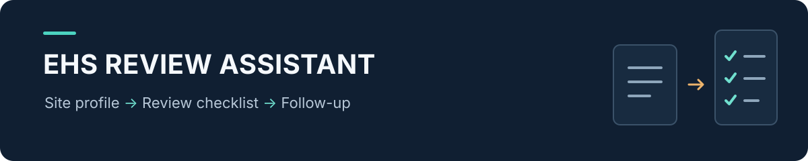
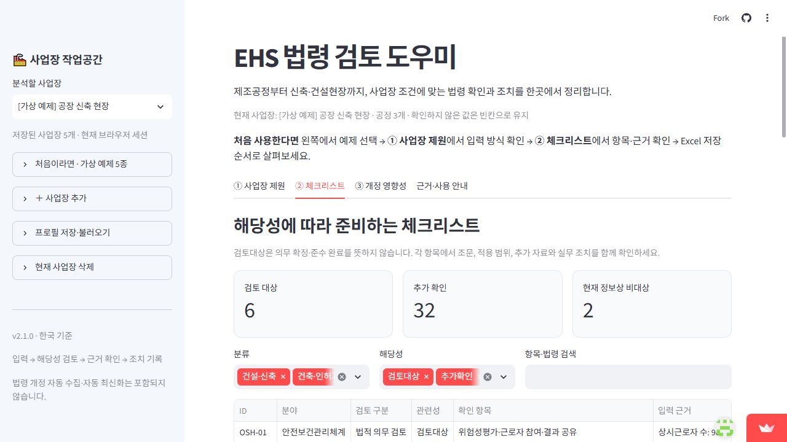

# EHS 법령 검토 도우미

**사업장 정보를 입력하고, 확인할 법규·증빙·후속 조치를 한곳에 정리하는 웹앱입니다.**

[공개 앱 체험하기](https://ehs-system-dpxks.streamlit.app/) · [법령 출처와 검토 범위](LEGAL_SOURCES.md)

`개인 프로젝트` · `Python` · `Streamlit` · `AI 협업 구현`

## 실제 화면



가상 공장 신축 현장의 입력값으로 관련 항목을 선별한 화면입니다. 예제를 선택하고 체크리스트의 근거와 증빙을 따라가며 사용 방식을 살펴볼 수 있습니다.

## 기획 배경

제조업과 공사 현장의 안전 업무에서는 공정·인원·건축물·물질·설비에 따라 확인할 사항이 달라집니다. 법령을 찾는 과정에 더해, 어떤 자료가 부족하고 누가 언제까지 확인해야 하는지도 정리할 필요가 있습니다.

이 앱은 **사업장 제원 → 관련 항목 선별 → 근거·증빙 확인 → 조치 기록**을 연결합니다. 처음 사용하는 사람도 입력 방식을 살펴볼 수 있도록 제원이 채워진 가상 사업장 5개를 제공합니다.

## 사용 흐름

1. **예제 선택**: PCB 습식공정·프레스·식품 제조·물류창고·공장 신축 중 하나를 선택합니다.
2. **사업장 제원 확인**: 인원, 건물 용도·면적·층수, 화학물질, 설비와 위험작업 정보를 확인하거나 수정합니다.
3. **체크리스트 검토**: 관련 항목의 조건·공식 출처·필요 증빙을 확인하고 담당자·기한·진행 상태를 기록합니다.
4. **개정 영향성 검토**: 공식 개정 원문과 법적 상태를 입력하고, 사업장별 관련성·수치 조건·부족한 정보를 살펴봅니다.
5. **결과 저장**: Excel·CSV로 검토 결과를 내려받고, 프로필 JSON으로 입력과 기록을 저장·복원합니다.

예제는 모두 사용 방법을 보여주기 위한 가정이며 실제 회사 자료가 아닙니다.

## 주요 기능

| 기능 | 구현 내용 |
|---|---|
| 다양한 사업장 입력 | 클린룸·PCB·프레스·화학배합·식품·물류·공장 신축 등 시작 템플릿 15종, 공정 복수 선택 |
| 상세 제원 | 숫자 항목 31개, 여부 항목 34개와 건물·물질·설비별 명세 |
| 조건에 따른 항목 선별 | 등록된 검토 항목 40개에 대해 입력 조건과 확인이 필요한 자료 표시 |
| 후속 조치 관리 | 담당자·기한·메모·진행 상태 기록, 제원 변경 시 기존 검토 기록의 재확인 처리 |
| 개정 영향성 | 원문의 관련 주제·인용문·수치 조건·시행 시점·누락 정보를 구분하고 여러 사업장 비교 |
| 저장과 복원 | Excel·CSV 출력, 프로필 JSON 저장·불러오기, 삭제한 가상 예제만 다시 추가 |

### 판단 흐름에서 신경 쓴 점

- **미확인은 ‘아니오’와 구분합니다.** 숫자를 모르면 빈칸으로 두고 추가 확인할 항목을 남깁니다.
- **법적 상태를 구분합니다.** 현행 법령, 공포·시행 예정, 입법예고, 국회 법률안을 별도로 입력합니다.
- **조건이 바뀌면 다시 확인합니다.** 사업장 제원 변경 후 이전 완료 기록과 개정 분석을 그대로 사용하지 않도록 처리했습니다.
- **결과의 근거를 함께 보여줍니다.** 항목명뿐 아니라 조건·공식 출처·필요 증빙을 확인할 수 있습니다.

## 기획자 역할과 개발 방식

환경안전 업무 경험을 바탕으로 입력 항목과 사용 흐름을 구상하고, 기존 초안에서 필요한 개선 사항을 정리했습니다.

- 특정 산업에 치우친 사업장 선택지를 제조공정과 건설·신축 현장으로 확장하도록 요구사항 정의
- 사업장 입력부터 법규 검토·조치 기록·파일 저장까지 화면과 업무 흐름 검토
- 초보 사용자를 위한 가상 예제와 학습 포인트 구성 요청, 미리보기 확인
- 생성형 AI와 협업해 Python·Streamlit 코드 구현 및 개선

개인의 기획·학습용 프로토타입으로 제작했으며, 코드 구현에는 AI의 도움을 받았습니다.

## 로컬 실행

```powershell
git clone https://github.com/Safety-Bin/ehs-system.git
cd ehs-system
python -m venv .venv
.\.venv\Scripts\python.exe -m pip install -r requirements.txt
.\.venv\Scripts\python.exe -m streamlit run app.py
```

## 검증 범위

저장소에는 조건 평가·누락값·수치 경계·개정 문서 상태·파일 출력·가상 예제·화면 흐름을 확인하는 **47개 테스트**가 포함되어 있습니다. 검증 대상은 앱의 처리 로직과 화면 동작입니다.

**최근 확인:** 2026-10-18 로컬 환경에서 47개 테스트 통과. 이때 확인한 앱 소스 5개는 공개 저장소의 소스와 일치했습니다.

```powershell
.\.venv\Scripts\python.exe -m unittest discover -s tests -v
```

| 파일 | 역할 |
|---|---|
| `app.py` | 화면, 사업장 관리, 검토 기록과 파일 저장 |
| `profiles.py` | 제원·공정·템플릿·가상 예제와 입력 정규화 |
| `legal_catalogue.py` · `core.py` | 검토 항목, 조건 평가와 Excel 출력 |
| `amendments.py` | 개정 원문과 사업장 입력의 관련성·수치·시행 시점 분석 |
| `LEGAL_SOURCES.md` | 공식 출처, 확인일과 판단 범위 |

## 사용 범위와 한계

법령 출처 확인 기준일은 **2026-10-12**입니다. 실시간 법령 수집·자동 최신화는 구현하지 않았으며, 개정 영향성은 사용자가 넣은 원문과 등록 조건을 바탕으로 분석합니다. 외부 LLM API로 법령을 판정하는 구조는 아닙니다.

등록된 항목은 검토의 출발점입니다. 별표·부칙·적용 제외·지역 조례·개별 허가 조건을 포함한 최종 적용 여부는 공식 자료로 확인해야 합니다. 현장 도입이나 업무 효과를 검증한 실적은 포함하지 않습니다.

입력과 검토 기록은 현재 브라우저 세션에 보관됩니다. 다음 접속에서도 사용하려면 프로필 JSON을 저장해 다시 불러와야 합니다.
